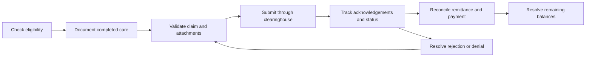
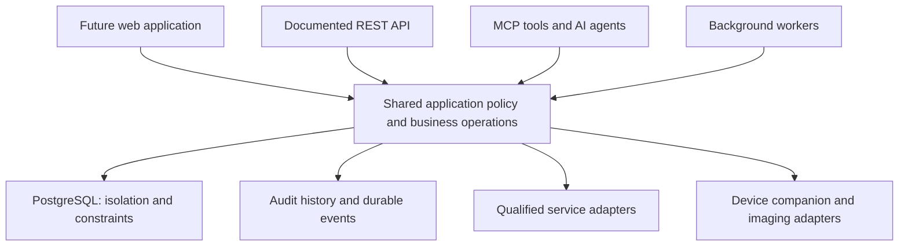

# CuspAtlas

### More time for care. More control for practices.

An open-source dental practice platform built around complete workflows, dependable automation, and ownership of your data.

  

[Vision](#why-cuspatlas) · [Capabilities](#the-practice-workflow) · [Architecture](#one-platform-one-set-of-rules) · [Deployment](#your-platform-your-choice) · [Contribute](#get-involved)

---

> **Early development · Synthetic data only**
>
> CuspAtlas is not ready for patient care. The default branch contains specifications and build plans; backend implementation is progressing on development branches. Capabilities below describe the intended product, not a released feature checklist. Product UI design remains deferred.

## Why CuspAtlas

Running a practice should not mean entering the same information repeatedly, chasing claims across disconnected systems, or losing access to your data when you switch software.

CuspAtlas is being developed to connect the entire practice workflow—from the first appointment request to completed care and reconciled payment—with automation that does useful work and makes exceptions easy to resolve.

| Product pillar | What it means for a practice |
| --- | --- |
| **Time returned** | Routine administrative work advances under practice-defined authorization. Staff focus on exceptions and patient care. |
| **Ease of use** | Clear language, sensible defaults, minimal repeated entry, accessible workflows, and actionable recovery when something fails. |
| **Practice ownership** | Open software, supported self-hosting, guided migration, and complete export paths. |
| **Connected operations** | Clinical, financial, scheduling, and communication workflows share context while preserving their separate records and responsibilities. |
| **Accountable automation** | API, MCP, AI, and background jobs follow the same permissions, business rules, and audit requirements. |

**Every CuspAtlas software feature remains free and open source.** Paid offerings cover setup, hosting, managed operation, and support—not additional software capabilities.

## The practice workflow

US general dentistry is the initial focus. Other countries and specialties are extensibility goals, not launch promises.

| Area | Planned scope |
| --- | --- |
| Patients and scheduling | Identity and households, intake, appointment requests, resource-aware booking, waitlists, recall, and attendance |
| Clinical records | Charting, periodontal records, histories, treatment planning, consent, notes, signing, and amendments |
| Billing and insurance | Estimates, ledgers, payments, payment plans, eligibility, claims, attachments, denials, remittances, and reconciliation |
| Imaging and devices | Qualified imaging integrations, patient-context handoff, image return, and a native companion where device access requires it |
| Patient engagement | Portal access, forms, reminders, communication preferences, delivery tracking, and follow-up |
| Practice operations | Roles and permissions, work queues, reporting, audit trails, backup and recovery, and operational monitoring |
| Migration and portability | Guided imports, record matching, attachment integrity, financial reconciliation, historical access, and exports |
| API, MCP, and AI | Documented business operations, controlled automation, proposal and approval flows, and integration parity |

[Capability matrix](docs/CAPABILITIES.md) · [Product specification](docs/superpowers/specs/2026-11-03-dental-pms-design.md)

## Claims, from eligibility to reconciled payment

The goal is a complete revenue-cycle workflow—not simply generating a claim or drafting an appeal.

The billing plan covers claim preparation, attachment requirements, duplicate prevention, submission receipts, status follow-up, rejections, denials and appeals, remittance matching, payment allocation, and remaining balances.

Routine, deterministic steps should execute under standing practice authorization. Missing documentation, ambiguous matches, payer exceptions, and decisions requiring professional judgment become focused work items with context and a clear next action.

Eligibility, estimated coverage, submission, payer acceptance, and payment remain separate facts. Automation must preserve that distinction and recover safely from retries, delays, and partial failures.

[Billing and revenue-cycle plan](docs/superpowers/plans/2026-11-04-billing-and-rcm.md) · [Practice-time and automation requirements](docs/PRACTICE-TIME-AND-AUTOMATION.md)

## One platform, one set of rules

The technical direction is **web-first TypeScript with PostgreSQL**, supported Supabase services, and a self-hosting path. An optional native companion handles device integration where required. Rust is a candidate; SDK and operating-system requirements determine adapter technology.

The architecture requires:

- **Controlled programmatic access:** API and MCP expose business operations through shared authorization and validation. Agents do not receive unrestricted database access.
- **Independent data protection:** tenant isolation, database constraints, scoped access, and negative permission tests reinforce application checks.
- **Reliable execution:** durable jobs, idempotency, optimistic concurrency, explicit failure states, and reconciliation prevent silent duplicate or lost work.
- **Preserved history:** signed clinical records and posted financial records change through amendments or reversals, with an attributable audit trail.
- **Replaceable integrations:** adapter contracts describe supported operations, configuration, qualification, failures, and recovery.

[Architecture](docs/AI-PMS-ARCHITECTURE.md) · [API and MCP contract](docs/API-AND-MCP.md) · [Shared engineering contracts](docs/SHARED-CONTRACTS.md)

## Your platform, your choice

The deployment plan provides three ways to operate the same open product:

| Option | Who operates it | What you pay CuspAtlas for |
| --- | --- | --- |
| **Self-managed** | Your practice or chosen IT team | Nothing required; optional setup and support |
| **Managed on your infrastructure** | A delegated operator using practice-owned infrastructure and accounts | Setup, managed operation, and support |
| **Hosted for you** | We operate the hosting environment | Hosting, setup, and support |

There are no planned proprietary feature keys, paid-only connectors, security tiers, or software feature paywalls.

### Bring your own database and services

Guided onboarding is intended to support qualified PostgreSQL/Supabase configurations and practice-owned service accounts. It should explain what each connection enables, verify prerequisites, keep credentials server-side, and show a useful next step when configuration fails.

Connections include email, SMS and voice, AI providers, clearinghouses, payments, prescribing, imaging, object storage, and backups. An API key alone is not enough for every integration: some require enrollment, agreements, identity verification, or device qualification.

**Free software does not mean unlimited free infrastructure or third-party usage.** Hosting, communications, AI inference, payment processing, clearinghouses, hardware, and other services may carry their own costs and terms. Those dependencies must be visible during setup.

[Open-platform and onboarding requirements](docs/OPEN-PLATFORM-AND-ONBOARDING.md) · [Integration qualification](docs/HARDWARE-AND-CLAIMS-QUALIFICATION.md)

## Security and responsible AI

Security, recovery, and AI governance are engineering requirements from the beginning. The plans cover least-privilege access, tenant isolation, private storage, protected credentials, attributable actions, backup and restore verification, and operational ownership.

AI actions must respect practice permissions, approved data-handling policies, use-case evaluations, and appropriate review boundaries. Clinical judgment and signing remain with authorized professionals.

ISO 27001 and ISO 42001 are assurance targets—not certifications already held. Self-hosting does not automatically confer compliance, certifications, or operational readiness.

[Security and release gates](docs/SECURITY-AND-READINESS.md) · [Assurance requirements](docs/ASSURANCE-AND-CERTIFICATION.md) · [Security reporting](SECURITY.md)

## Project status

| Layer | Current position |
| --- | --- |
| Product and architecture | Specifications, shared contracts, acceptance scenarios, and workstream plans are on the default branch. |
| Backend implementation | Synthetic backend work is on development branches. Review the relevant commit and its checks for implementation evidence. |
| Product UI | Deferred; no patient-ready application experience is offered here. |
| Real-world integrations | Device and service qualification remain release requirements; broad compatibility is not established. |
| Practice release | Production operations, clinical validation, migration validation, and release gates remain prerequisites. |

[Development branches](https://github.com/cyog941/cuspatlas/branches) · [Pull requests](https://github.com/cyog941/cuspatlas/pulls) · [CI runs](https://github.com/cyog941/cuspatlas/actions)

A passing synthetic test suite is evidence for a specific implementation and environment. It is not proof of clinical safety or production readiness. There is no patient-ready installer or product demo on this branch.

## Documentation and build plans

Start with the [design specification](docs/superpowers/specs/2026-11-03-dental-pms-design.md), [readiness review](docs/READINESS-REVIEW.md), and [roadmap](docs/ROADMAP.md). Developers should read the [shared contracts](docs/SHARED-CONTRACTS.md) and [synthetic foundation runbook](docs/superpowers/plans/2026-11-03-foundation-execution-runbook.md) before the relevant workstream plan.

<strong>Explore all nine workstreams</strong>

| Workstream | Implementation plan |
| --- | --- |
| F · Platform core | [Foundation](docs/superpowers/plans/2026-11-03-platform-foundation.md) |
| S · Patients and scheduling | [Scheduling and patients](docs/superpowers/plans/2026-11-04-scheduling-and-patients.md) |
| C · Clinical record | [Clinical record](docs/superpowers/plans/2026-11-04-clinical-record.md) |
| B · Billing and insurance | [Billing and revenue cycle](docs/superpowers/plans/2026-11-04-billing-and-rcm.md) |
| I · Imaging and devices | [Imaging and devices](docs/superpowers/plans/2026-11-04-imaging-and-devices.md) |
| E · Patient engagement | [Portal and communications](docs/superpowers/plans/2026-11-04-portal-and-communications.md) |
| A · API, MCP, and AI | [Programmatic access and automation](docs/superpowers/plans/2026-11-04-api-mcp-and-ai.md) |
| M · Migration and operations | [Migration and operations](docs/superpowers/plans/2026-11-04-migration-and-operations.md) |
| R · Supported release | [Release qualification](docs/superpowers/plans/2026-11-04-supported-release.md) |

[Acceptance scenarios](docs/ACCEPTANCE-SCENARIOS.md) · [Workflow and role matrix](docs/WORKFLOW-ROLE-MATRIX.md) · [Architecture decisions](docs/ADR-REGISTRY.md)

## Get involved

**Dental teams:** help define workflow exceptions, migration expectations, and measurable time savings. Use synthetic examples; never include patient information in issues, screenshots, logs, or fixtures.

**Developers:** review the relevant branch, contracts, and acceptance conditions. Follow that branch's setup instructions rather than treating this documentation branch as an installable application.

**Integration partners:** help qualify supported devices, documented interfaces, sandbox workflows, enrollment requirements, and failure recovery.

Read [CONTRIBUTING.md](CONTRIBUTING.md) before submitting work. Substantive proposals should describe the practice problem, expected behavior, and how it will be verified. Follow [SECURITY.md](SECURITY.md) for security reports.

## License

Copyright © 2026 CuspAtlas contributors. Licensed under **[AGPL-3.0-or-later](LICENSE)**. Third-party software, services, and terminology datasets retain their own licenses and terms.
