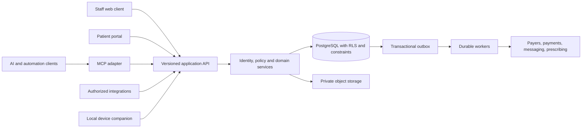

# CuspAtlas: product and architecture design

Date: 2026-11-03. Status: reviewable planning proposal; no implementation authorized.

## Intent and decision ownership

The user's objective is a free, open-source, secure dental PMS with end-to-end practice functionality, AI assistance, MCP connectors, and comprehensive programmatic control. An existing PMS is a workflow reference. The user explicitly chose **US general dentistry first**, authorized foundation setup and investigation, and deferred UI design. Language and platform choices below are engineering recommendations made under the user's direction to proceed; they are not represented as separately approved choices.

The first customers to validate with are independent practices and small groups. Design for multiple locations from the outset, but do not pretend that solo-practice validation proves enterprise readiness. International payer rules, local prescribing, and specialty-specific workflows are later release programs.

## What would make this valuable

User-directed pillars (2026-11-04): intuitive use, minimal repeated entry, easy migration and maximum safe automation across the practice. The [practice time and automation contract](../../PRACTICE-TIME-AND-AUTOMATION.md) is normative product scope: CL-01–12 cover the full care-to-claim-to-payment journey; PT-01–06 cover cross-practice time savings; MG-01–05 define migration/exit; UX-01–03 define usability acceptance. Routine deterministic work may execute under explicit revocable standing policy, with exception-first human review. AI remains read/draft until evaluated; required clinical signatures and material judgments are preserved. UI design stays deferred.

Compete on dependable daily operations and switching cost, not a large feature checklist or an AI label. The proposed differentiators are: portable records with reconciled exports; predictable ownership costs; a usable end-to-end workflow; integrations without a special API license; and automation that can show exactly what it did and why it was allowed. Treat these as hypotheses to validate with practices, not established market findings.

Before declaring product-market fit, measure time to complete a routine visit, booking/reconciliation errors, migration exceptions, hours spent on billing follow-up, staff adoption, support burden, and total cost per location. Establish baselines with consenting pilot practices before setting improvement claims.

The reference PMS's captured public page itself advertises REST APIs and an on-demand MCP server. Therefore API/MCP availability alone is not a credible differentiation claim. The proposed distinction is unrestricted open-source access to the supported contracts, transparent policy and costs, operational reliability and verifiable portability. Actual incumbent commercial access/terms were not inspected.

## Goals, non-goals and anti-goals

Goals: one reliable patient/practice record; scheduling through follow-up and collections; permission-equivalent UI/API/MCP; self-hosting and complete exit/export paths; clinician-controlled AI; accessible, auditable operations.

Not now: product implementation, mockups, styling, production hosting, patient migration, autonomous diagnosis, native radiology AI, custom sensor drivers, universal offline sync, nationwide prescribing certification, or claims-network contracts.

Anti-goals: a paid-only API; unreadable exports; agent superuser credentials; a mock dashboard marketed as a PMS; copying reference PMS's proprietary implementation; silent clinical edits; payment success inferred from a booking; or calling a development service HIPAA-compliant.

## Approaches considered

| Option | Dental-practice benefit | Cost and failure modes | Decision |
|---|---|---|---|
| Browser application + optional desktop companion | Shared release, operatories/tablets/remote users, thin device integration | WAN dependence for cloud deployment; companion lifecycle | Recommended |
| Desktop-first + practice server | Local operation independent of WAN; familiar device access | Practice IT/backup burden, remote access, upgrade drift | Supported deployment concept later, not separate initial client |
| Fully offline-first clients + bidirectional sync | Maximum connectivity tolerance | Conflicting chart signatures, bookings, merges, ledger allocations and revocations | Defer until specific validated demand and conflict design |

**Recommendation: one web application with an optional narrow desktop companion.** Web is the product interface; the companion is a hardware/security boundary, not a second PMS. Cloud-first is not cloud-only: a maintained self-hosted deployment must be supported. A clinic-LAN deployment can remain usable when the WAN fails, but payer, SMS, hosted AI, remote access and prescribing still require external connectivity. This is distinct from synchronizing independent offline clients.

### Language and stack decision

| Layer | Proposed choice | Reason and validation requirement |
|---|---|---|
| Staff and patient web applications | TypeScript + React; Vite build for the authenticated app | Shared browser capability and contributor accessibility; no SEO need for patient records. Select component system during later UI design. |
| Domain/API service | TypeScript on supported Node LTS; Fastify; JSON Schema/OpenAPI | One validated command/query contract across clients; modular service rather than UI framework-specific business logic. Runtime validation remains mandatory. |
| Data | PostgreSQL; SQL migrations and explicit transaction boundaries | Relational integrity, precise financial transactions, scheduling locks, tenant policies. SQL remains authoritative; evaluate a thin typed query builder later. |
| Identity/storage/realtime | Supabase, behind explicit adapters | Fast foundation with a self-hosted path; keep core domain data portable. Do not require managed-only features for core correctness. |
| Durable jobs | PostgreSQL transactional outbox + worker initially | No extra queue vendor to operate on day one; benchmark contention and retries before adopting additional infrastructure. |
| API SDK and MCP | Generated TypeScript SDK and thin MCP adapter | Reuse contracts and policy; no duplicate business logic or privileged backdoor. |
| Device companion | Rust service; Tauri only if a local interface is justified | Narrow local-file/device capabilities and signed distribution. Vendor and hardware compatibility takes precedence over language purity; the specific SDK and OS requirements are an assumption to be verified in the device qualification matrix, not an established fact. |
| AI | Provider-neutral adapter; local models optional | Model choice is a deployment/policy choice; model outage must not disable care workflows. |

Rust can reduce classes of memory errors in native components. It does not prevent authorization mistakes, lost clinical updates, flawed financial logic, or PHI disclosure. TypeScript is chosen for shared contracts and development simplicity, not a claim that it is inherently safer or faster. A full Rust backend is a valid later choice only if measured constraints justify the rewrite/maintenance cost. Python may support offline evaluation tooling later; it is not another core runtime by default.

Version pins are intentionally not invented now. At implementation, select supported versions, record them in an ADR, commit lockfiles, and establish an upgrade policy. Do not install an application framework in this planning phase.

## System shape

Start as a modular monolith plus workers. Module boundaries: identity/tenancy; patient identity and consent; scheduling; clinical records; treatment planning; imaging/documents; billing/ledger; insurance/claims; communications; recall/tasks; reporting; integrations/automation. Each module owns its writes and publishes versioned events. Reporting reads projections with documented freshness. No microservices or global event-sourced database until a real operational need appears.

### Tenancy and deployment

Tenant = practice organization; locations and operatories belong to a tenant. A patient belongs to that tenant, and may visit its locations under authorized sharing rules. Do not automatically create a global patient graph. Staff memberships can span tenants but each request has one verified tenant context. Guarantor, family, minor guardian and portal proxy access are separate relationships.

Initial pilot recommendation: isolated deployment/database per practice organization, with tenant-aware schema and policy still tested. Shared SaaS tenancy is a later opt-in deployment requiring isolation testing and incident containment design. This gives an initial operational boundary without promising that database separation alone supplies compliance. Dev, staging and production are separate resources; use synthetic data outside production.

Recommended SQL boundary: private domain schemas; Data API exposure disabled for clinical/financial tables by default. Normal application connections use a non-owner, non-BYPASSRLS role. Inside a transaction the trusted API establishes validated actor/tenant context; connection-pool cleanup and context leakage must be tested. Clients never get database credentials or a service-role key. Supabase Auth/Storage access is narrowly scoped; policy in the service and RLS must agree. Public portal operations use an explicit constrained facade, not arbitrary table access.

### Critical correctness model

- Separate AppointmentRequest, Appointment, Encounter, Procedure, TreatmentPlan, ClinicalNote, Claim, Payment and Allocation. Booking completion does not imply treatment completion; billing state never proves attendance.
- Appointment facts stay separate: request, booking, attendance, procedure completion and billing are distinct records with their own transitions, actors and timestamps, and confirmation keeps its source so a manual confirmation stays distinguishable from an automated one. Transition policy and authorized actor are explicit per fact. Rescheduling preserves a linked history; recurrence exceptions are individual events. Corrected: this bullet previously described one appointment state machine running from request to no-show, which the observed incumbent status field motivated by carrying several kinds of fact at once; see "Domain model informed by the incumbent".
- Procedure states include proposed/accepted/scheduled/completed/declined/discontinued, with versioned estimates; these belong to the item level of the treatment hierarchy, and accepting a plan version is a separate decision at plan level. Clinical notes have draft/signed/amended states; signing freezes content and preserves signer/time/version.
- Patients can have primary, secondary and changing coverage. Eligibility and estimates record source/time/limits; an estimate is not a payer guarantee.
- Financial journal entries are balanced and immutable after posting. Separate charges, discounts, contractual adjustments, patient money, insurer money, transfers, refunds, write-offs and unapplied credit. Correct by reversal and replacement. Allocations cannot exceed available funds; currency and rounding rules are explicit.
- Domain changes, audit metadata and outbox event commit atomically. External actions have idempotency keys, delivery receipts, deduplication and reconciliation. A timeout is an unknown result to reconcile, not permission to repeat a charge.
- Scheduling verifies provider/operatory/resource constraints transactionally; use exclusion constraints or locking plus validation rather than trusting a visually empty grid. Authorized overrides require reason, identity and audit.
- Export is a product capability: versioned JSON/CSV, attachments and checksums, terminology/version references, history and financial allocation provenance. Imports retain source IDs, time precision and unresolved exceptions.

## Domain model informed by the incumbent

The authenticated observation pass produced requirements, not a description of the incumbent's internals. Everything below is a derived requirement: the observation is stated as the basis, and the decision that follows from it is ours. Observations come from [the authenticated surface map](../../REFERENCE-WORKFLOW-MAP.md), [the HTTP surface](../../REFERENCE-API-OBSERVATIONS.md), [the domain model](../../REFERENCE-DOMAIN-OBSERVATIONS.md) and [the status vocabularies](../../REFERENCE-STATE-VOCABULARIES.md). Where an observation is silent, this section says so rather than filling the gap from plausibility.

Observation was read-only. No transaction was executed, and no record was created, edited, saved, submitted, posted or exported while producing it. Transition guards, role enforcement and error semantics are therefore unobserved here and are listed as such at the end of this section.

### Appointment facts must not collapse

Observed basis: the appointment Status selector lists seventeen rows, of which sixteen are status labels and one is an `-- All --` filter sentinel. The sixteen mix at least five kinds of fact: lifecycle position (`Scheduled`, `Confirmed`, `Confirmed (auto)`), physical presence (`Checked-In`, `Curbside Check-In`, `In Chair`, `Waiting`, `Checked-Out`), clinical completion (`Treatment Complete`), financial completion (`Billed`) and exception or terminal outcomes (`Late`, `No Show`, `Left Without Treatment`, `Canceled`, `Reschedule`). `ASAP` sits in the same list but is a priority rather than a position in any lifecycle. `Confirmed` and `Confirmed (auto)` are distinct values.

Derived requirements:

- Five independent facts: appointment request, booking, attendance, procedure completion and billing. Each carries its own transitions, acting user, timestamps and correction history. No single stored field may stand for more than one of them, and no derived display status is authoritative.
- A booking records how confirmation was obtained, with provenance. Manual and automated confirmation remain separate facts, because a no-show rate per reminder policy cannot be measured if the two collapse.
- `ASAP` is a priority or ordering flag on a request or booking, with no lifecycle effect.
- Our status vocabularies contain stored states only. Filter sentinels such as "all" belong to the query contract and never appear in persisted data.
- Cancellation, no-show and departure are attendance outcomes. They never delete or overwrite the booking, the clinical facts recorded during the visit, or the financial facts the visit produced.

The grouping of labels is our classification; the labels themselves are observed configuration.

### An appointment may hold no resource

Observed basis: ten operatory values are configured, and two of them are not physical rooms. Two labels name exception states; whether staff actually book into them was not observed. Operatory labels are free text carrying their own ordinal prefix, which duplicates the ordering already implied by display order.

Derived requirements:

- An appointment's operatory reference is nullable. "No operatory" is a valid stored state and must never be modelled by inventing a synthetic room.
- When an appointment holds no resource, a typed exception reason is required, beginning with the observed no-show and cancellation cases, and that reason participates in conflict checks, reporting and audit.
- Resources are identified by stable ids. Display labels are mutable, are never identity, and never carry ordering; order is explicit data.
- Conflict detection treats "holds no resource" as its own case rather than skipping the constraint. A visually empty grid is not evidence of availability.
- Resource type is declared (room, chair, equipment, provider-grouped resource) rather than inferred from a label.

Naming and taxonomy of these controls are our decisions; the two non-room values are observed configuration.

### Treatment is three levels, audited separately

Observed basis: the audit record selector lists treatment plan, treatment detail and treatment item detail as three separate auditable record types.

Derived requirements:

- Three levels with distinct identity and lifecycle: plan (the clinical proposal, including alternatives, for a patient over time), detail (the per-tooth or per-area grouping or phase within a plan) and item (the specific procedure instance with its code and fee).
- Do not flatten plan or detail into a single "planned procedure" row. An accepted plan version pins its details and items; a fee or coverage change produces a new version instead of editing one in place.
- Consent and estimates attach to the plan version the patient accepted and are referenced downward, not duplicated per item.
- Audit entries name the level that changed. An edit to an item is not an edit to the plan and must not be reported as one.

The level names are observed; the separation and its audit consequence are our requirement.

### Coverage: book, catalogue and resolved payer identity

Observed basis: the audit taxonomy separates insurance and insurance plan from coverage book and coverage book detail, and also lists a subscriber-to-plan association. Claims filters offer 26 configured carriers, among them near-duplicates of a single payer distinguished only by punctuation, a trailing symbol, a suffix, or a mailing address embedded in the name.

Derived requirements:

- A patient's coverage book is a versioned record (subscriber, plan assignment, order of benefits, effective dates, provenance) separate from the carrier plan catalogue (payer, plan and network definitions). Editing a catalogue entry must not silently rewrite a patient's coverage history.
- Carrier identity is resolved, not typed. Each carrier has a canonical id, a set of alias strings observed from outside, and a mapping from each observed alias to the canonical id.
- The alias string is preserved verbatim on the record that carried it (claim, eligibility response, statement) beside the canonical reference, so a payer dispute traces to the text actually sent or received.
- Alias matching is data with provenance and review, not ad hoc string comparison in code. Adding an alias and merging two carrier entries are audited, reversible administrative actions.
- An unrecognised alias routes to an exception worklist. It does not silently create a new carrier or fork that payer's reporting.
- Financial and production reporting aggregates by canonical carrier, so duplicate aliases cannot produce duplicate totals.
- A payer-supplied Payer ID is an attribute of the canonical carrier, not the identity of a practice's carrier row.

The duplicate rows observed in a single practice are ordinary data-quality reality, not a vendor defect. The requirement is that resolution is explicit and auditable.

### Statement generation, payment posting, claim submission and note signing are commands

Observed basis: statement generation is itself an audited record type, and the money group of the audit taxonomy includes check, credit card and payment plan objects. The observed audit action set is delete, edit and login.

Derived requirements:

- Each of statement generation, payment posting, claim submission and note signing is a command with an identified actor, tenant, timestamp, target, input digest, outcome and idempotency key. Each is executed as a command, never as a read that happens to emit an artifact or a side effect.
- Statement generation records the balance snapshot, the service-date or cutoff basis, and the version of the statement body that produced the artifact. A regenerated statement is a new generation event citing the prior one; it does not overwrite it.
- Payment posting is a balanced journal operation. Correction is by reversal and replacement, and reprinting a receipt is not a new posting.
- Claim submission records the exact claim version and the partner acknowledgement. A resubmission cites the rejected version.
- Note signing is our design decision rather than an observation: signing freezes a version and records signer, time and reason for any later amendment. Signed-note audit in the incumbent was not observed.
- Decide explicitly whether card data is ever stored. If a processor tokenises it, the token, its scope and its lifecycle are auditable, and card expiry is data we deliberately hold so a charge can be attempted before a card expires.

### Audit coverage is driven by a registry

Observed basis: the audit screen exposes an action selector, a record selector and an actor selector, with 26 record types in six groups (scheduling, patient and identity, clinical, insurance, money, organisation). The observed action set is delete, edit and login.

Derived requirements:

- A registry of auditable entity types is the source of truth for what audit covers. An entity that is not registered cannot be created or changed, and the build fails when a type exists in the domain without a registry entry, so a new entity cannot ship unaudited by omission.
- Each registration declares the entity's identity, the actions that must be recorded, the sensitive fields that must be redacted in audit views, the retention class, and which read and export events are audited for that type.
- Adding an entity is one change that includes its audit registration and its negative tests. Deferred audit coverage is a release blocker, not a follow-up task.
- Our taxonomy is our own. The observed 26 types and three actions are evidence that coverage must be broad, not a list to copy. Read access and export are audit-worthy for us even where the observed selector does not suggest they are.

### API conventions we do not reproduce

| Observed convention | Basis | Our rule |
|---|---|---|
| Session token as a URL path segment | Paths of the form `/api/<vendor-prefix>/<resource>/{token}/{clinicId}` were observed across the session | Credentials travel only in the `Authorization` header. No token, session or secret appears in a path, query string, response body or document URL. Our gateway scrubs path and query credentials from logs, traces, referrers and error payloads as a fixed rule. |
| Tenant named by the caller | Nearly every call carries a clinic id, and the token is not obviously bound to one; whether the server rejects a clinic id outside the token's scope could not be tested | Tenant and actor are derived from authenticated context. A client-supplied tenant value is at most a selection hint and is rejected when it does not match the authenticated scope. Every endpoint needs negative cross-tenant tests before acceptance. |
| Verb overload on one path | The same path shape answers GET, POST and PUT for different operations | One operation, one explicit resource path, with a method that matches intent. No path carries several meanings. |
| Status carried inside HTTP 200 | 46 of 50 captured API responses used a `{status, data}` body inside HTTP 200; four used a different shape, and the other 46 of the 96 records were static assets, not API calls | Use HTTP status codes honestly, plus a stable error code and correlation id in the body. A client must never parse a body field to learn that a request failed. Error behaviour was unobserved, so this is a rule about shape, not a comparison of outcomes. |
| Build and client configuration in a bootstrap payload | The client bootstrap returns a version, a commit and a minification flag, together with payment-provider client configuration | Clients receive no build-mode, minification or debug flags, and no configuration beyond what that client's role requires. Build identity is logged server-side, not served. |

Two conventions from the same observation are worth adopting deliberately rather than by accident: opaque pagination cursors and caller-selected projection on bulk fetches. Both become documented behaviour, with short cursor lifetimes, a safe default projection and an explicit maximum.

### Payment plans need expiry and failure states

Observed basis: plan columns include due date, plan date, total amount, authorization, installment, balance, overdue, card expiry, plan status and auto-pay, with plan-value and monthly-run-rate tiles. Worklist labels for pending, defaulted, missing-signature, completed, uncollected and void plans were seen in an earlier pass; the plan status vocabulary itself was not enumerated, and transition rules were not tested.

Derived requirements:

- Card expiry and failed automatic payment are first-class states, not silent non-events. Each has its own worklist, owner and ageing.
- A payment attempt is a record (amount, time, processor result, idempotency key, retry count) kept separate from plan state. A failed installment does not disappear because the plan is still active.
- Auto-pay enrolment carries consent, the authorization under which it was granted, the payment-method reference, and a pause or revocation path. Revocation stops future attempts without erasing plan history.
- Authorization, schedule, collection and closure remain separate facts per the note at the end of this document. Expired card and failed payment are inputs to collection, not synonyms for a plan status.
- Plan value and monthly run rate are reporting measures over scheduled and posted installments, with declared definitions, time basis and freshness. They are not ledger facts.
- The lifecycle itself remains unobserved. Plan creation, authorization, retry and allocation behaviour were not executed; our state model is a requirement, not a verified transition graph.

### What remains unverified

- Status transitions. No transition was executed in any module. Permitted transitions, guards, which role may set each value, and whether transition history is retained are unobserved for appointments, treatment, payment plans and claims.
- Role enforcement. The audit actor selector is a user list, not a role matrix. No permission denial, revoked session or cross-tenant request was attempted, so neither surface-level nor record-level enforcement is established.
- Error semantics. Every observed response was a success. Validation failures, permission denials, conflicts, not-found, rate limits and partial failures are unobserved, including whether a failure is signalled by HTTP status or only by the body.
- Claim lifecycle. Claim and appeal status values exist as configuration. Submission, acknowledgement, rejection, correction, resubmission, ERA reconciliation and secondary claims were not observed.
- Transaction semantics generally: appointment save and conflict behaviour, ledger posting, statement cutoff and balance basis, plan creation and allocation, audit completeness, retention and tamper resistance, export completeness.
- Whether a client-supplied tenant id that the credential does not cover is rejected server-side. The requests needed to settle it would be abusive against a live practice and were not made.

Nothing in this section rests on a transaction. No appointment, payment, statement, claim, note or treatment record was created, changed or submitted while producing it, and no configuration was altered. Settling the unknowns above requires an authorized sandbox, not further observation of production.

## AI and full programmatic control

The [AI PMS architecture contract](../../AI-PMS-ARCHITECTURE.md) extends this design with eight proposed capability families: huddle preparation, clinical draft documentation, scheduling assistance, revenue-cycle assistance, treatment follow-up, financial explanations, analytics and workflow automation. Its module dependencies, protected proposal lifecycle, provider controls and evaluation gates are requirements for follow-on plans. They are proposed CuspAtlas behavior, not verified reference PMS behavior.

AI orchestration, authorized retrieval, proposal storage and provider adapters remain logical boundaries within the modular service/worker architecture. Deterministic domain services own calculations and mutations. Default action progression is read, recommend, draft, approve and execute; initial AI remains read/draft only. AI outages must leave ordinary care workflows usable.

Every supported business operation must have a documented API equivalent. MCP calls the same application command and query handlers. Parity does not grant all callers every permission, nor make clinical sign-off automatic. Separate read, draft, commit, clinical sign and financial execution scopes. Prescribing, payments, access administration and bulk outbound communication retain policy-controlled approval or staff roles.

Start AI with administrative explanations, source-linked summaries and draft notes/claim narratives. Untrusted notes/documents cannot instruct the agent to widen access or change a tool destination. AI output is labeled and records evidence/model/version; sensitive drafts require review before signing/submission. No autonomous diagnosis or radiograph interpretation at launch. AI is optional and basic care continues when it is unavailable.

See [API and MCP](../../API-AND-MCP.md) and [security gates](../../SECURITY-AND-READINESS.md).

## Device integration and downtime

The [hardware and claims qualification contract](../../HARDWARE-AND-CLAIMS-QUALIFICATION.md) defines the initial existing-acquisition-software bridge strategy, exact configuration qualification, device identity and image-return requirements, clearinghouse adapter boundaries, attachment provenance, payer enrollment and regulatory review gates. DentalXChange is the first public-API candidate to qualify, not a selected or contracted partner. Direct acquisition and diagnostic processing require intended-use review; no blanket regulatory exemption is assumed. Claims attachments require a versioned standards-transition plan, including review of CMS-0053-F and the May 26, 2028 compliance deadline described by CMS.

Do not promise universal sensors. First certify a small published device/driver/OS matrix against one pilot practice's inventory. Initially support safe image import and a validated bridge to existing acquisition software. Native acquisition is a separate milestone. Store originals, derived images and annotations separately, with identity matching, integrity hashes and access audit. A device companion accepts only paired, signed, narrowly scoped jobs; no arbitrary shell commands, paths or remote HTML with broad native access.

Cloud pilot requires a tested downtime runbook: secure minimal schedule/contact continuity, manual event numbering, later reconciliation, and verified backup/restore. No PHI in browser service-worker caches by default. Any future encrypted offline store must specify device enrollment, revocation limits during disconnection, TTL, conflict resolution and loss procedures. Financial/clinical conflicts must not use silent last-write-wins.

Provisional operational targets for pilot planning: RPO <=15 minutes, RTO <=4 hours, API availability target 99.9% excluding agreed maintenance, p95 ordinary command latency <500ms excluding external providers on a stated test dataset. These are proposed engineering acceptance targets, not current guarantees. Validate against a realistic practice workload and costs before committing an SLA.

## Assurance architecture

[Assurance and certification requirements](../../ASSURANCE-AND-CERTIFICATION.md) define AS-01 through AS-12: traceable control evidence, secure releases, privacy lifecycle, AI use-case/impact registry, model and prompt provenance, regression gates, human oversight, incident monitoring and self-hosting responsibility boundaries. They support organizational ISO/IEC 27001 and 42001 targets without asserting certification. Governance records may live in controlled external systems; sensitive evidence and licensed standards never enter public Git.

## Open-source and operating model

User-directed commercial contract: **all software features are free and open source; paid offerings cover setup, hosting/managed operation and support only**. The [open-platform onboarding contract](../../OPEN-PLATFORM-AND-ONBOARDING.md) defines supported bring-your-own PostgreSQL/Supabase, service connections, guided setup, protected secrets, qualification states, temporary support access and paid-service exit. Self-managed, practice-owned managed and vendor-hosted modes share feature contracts; certification and operational responsibility do not automatically transfer. No paid control plane or feature key is required for self-hosted operation.

Recommend AGPL-3.0-or-later for the core to preserve access to modifications used as a network service; evaluate permissive SDK licensing separately. This is a product recommendation, not legal advice. Preserve third-party notices, contributor provenance and DCO sign-off. No contribution terms that silently transfer ownership. Governance and release stewardship must outlive one founder.

Core, security controls, API, MCP, import/export and self-hosting remain free software. Optional managed hosting, migration, support and vendor usage can fund maintenance. Publish costs and dependencies; do not promise unlimited free cloud hosting or payer connectivity. Review terminology rights before distributing CDT or other licensed datasets. Use synthetic placeholder procedures in fixtures until licensed content is explicitly authorized.

## Validation and delivery gates

The [capability matrix](../../CAPABILITIES.md) defines the complete target, not the first milestone. The first credible replacement release must cover a supported practice's full ordinary day, including exceptions, migration reconciliation and recovery. An early scheduling demo is not that release.

### Explicit first-replacement contract

Required: patient/family/consent records; scheduling and requests; daily workflow; structured odontogram including surfaces and existing restorations; longitudinal six-site periodontal data; structured medical history/allergies/medications with provenance; signed/amended notes; treatment plans; image import plus a validated acquisition-software bridge; ledger/allocations/payment provider; primary and secondary dental claims, acknowledgements and ERA through a contracted tested adapter; patient portal/intake; recall; reports; permissions, audit, recovery and complete export. Every category is mandatory for the declared supported general-dentistry pilot; reducing scope requires labeling the release a limited trial rather than replacement-ready.

Direct sensor acquisition is not mandatory if the existing acquisition system and the certified bridge remain supported. E-prescribing/EPCS is integration-dependent but is a hard cutover blocker for any pilot whose workflow requires it; it must either have a validated integrated partner or an explicitly documented, clinician-approved continuing external workflow. Never silently omit it. Specialty depth and fully independent offline clients are excluded from the initial replacement claim. The pilot's vendor/device inventory must pass qualification before accepting that practice for cutover.

### Migration and cutover contract

First source-system target: the reference PMS, using practice-authorized exports or documented APIs whose rights and availability are verified. No private endpoint scraping is assumed. Planning now uses synthetic records only. Import active patient/family/consent data, future appointments, current medical history, chart/perio baselines, active treatment plans, insurance, open claims, unapplied credit and reconciled opening balances. Preserve original timestamps, source identifiers and provenance; never attribute imported signatures to a new clinician.

Historical notes, charts, images, claims and financial detail must remain accessible in a read-only, integrity-checked archive with patient-linked references and retention controls. Do not reinterpret past financial events as newly posted ledger transactions. If exports cannot deliver required history with acceptable fidelity, the pilot does not cut over until lawful accessible archival arrangements are verified. A complete native historical transaction importer is a later option, not an unspoken requirement for the first importer.

Run dry-run imports, compare row counts and per-account balances/allocations, verify attachments by checksum, and have clinical/financial staff sign off on exception lists. Use read-only parallel comparison, then an agreed write freeze and final delta. After cutover, only CuspAtlas is writable. A rollback after new work is not a database reset: capture and reconcile all post-cutover clinical/financial events into the restored incumbent under a pre-agreed runbook. Do not enable automatic dual writes. The archive, its access application, and export delivery are part of the supported data boundary and must meet the same privacy/recovery requirements.

### Supported self-hosting operator

The first supported self-hosted release assumes a named qualified IT administrator or contracted hosting/support operator, not a dentist personally operating containers. Deliver a versioned deployment bundle, documented hardware budget, backup and restore automation, monitoring/alerts, secret rotation, signed upgrades, rollback instructions and tested upgrade paths. The operator owns infrastructure, patches, access, recovery and incident response; maintainers own application security fixes and release documentation. A nontechnical one-click managed offer is a separate service, not a prerequisite to use the software. Until these artifacts and drills exist, self-hosting is a design objective, not supported production capability.

Plan: validate workflows and vendor/device constraints; approve contracts/security/data invariants; prepare synthetic acceptance scenarios and migration strategy; keep UI deferred until separately requested. Synthetic backend foundation may start on explicit build instruction without UI; clinical and interface validation still gates affected features. A later release must pass workflow review by clinical staff, ledger reconciliation, tenant isolation, penetration testing, restore drills and support readiness before PHI cutover.

## Known blockers and matters left to the builder

- Supabase development project cuspatlas-dev was created after the user upgraded Santi to Pro and authorized creation. Reference pfnuigldoshdldetkaqk, region us-east-2, independently verified ACTIVE_HEALTHY. No application schema or patient data has been added; existing projects were not changed.
- Direct attachment of the analysis tools to the authenticated in-app browser was initially not established. Corrected: it was resolved on the same evening through a dedicated Chrome profile with a loopback DevTools endpoint, where both tools attached to the same authenticated target and produced their own evidence. Authenticated observation now covers configuration and read-only surfaces; transaction semantics remain untested.
- Name is provisional; conduct trademark/domain review before launch.
- Select clearinghouse, payment processor, prescribing partner and certified hardware only after contracts, sandbox tests, costs, BAA scope and ownership are validated. No live vendor integration is configured.
- Choose exact package versions/query library during implementation; component library and screen design belong to deferred UI work.
- Pilot practice selection, detailed hardware inventory and staff validation remain pre-build/clinical-release discovery tasks. Do not import production data merely to accelerate research.

Sources and observation scope: [research ledger](../../RESEARCH.md).

Detailed observed/untested boundaries and the remaining instrumented-analysis gate: [reference PMS analysis coverage](../../WORKFLOW-RESEARCH-COVERAGE.md). Visible payment-plan lifecycle states require separate signature, schedule, collection and closure facts in our model. Statements require a versioned balance snapshot, service-date/cutoff basis, freshness indication and distinct generation/delivery/print events. These are proposed requirements derived from UI observation, not verified reference PMS transaction semantics.

