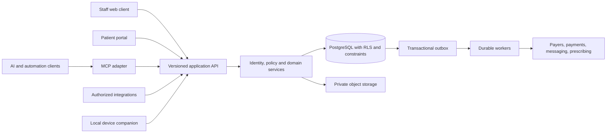

# CuspAtlas: product and architecture design

Date: 2026-11-03. Status: reviewable planning proposal; no implementation authorized.

## Intent and decision ownership

The user's objective is a free, open-source, secure dental PMS with end-to-end practice functionality, AI assistance, MCP connectors, and comprehensive programmatic control. Tab32 is a workflow reference. The user explicitly chose **US general dentistry first**, authorized foundation setup and investigation, and deferred UI design. Language and platform choices below are engineering recommendations made under the user's direction to proceed; they are not represented as separately approved choices.

The first customers to validate with are independent practices and small groups. Design for multiple locations from the outset, but do not pretend that solo-practice validation proves enterprise readiness. International payer rules, local prescribing, and specialty-specific workflows are later release programs.

## What would make this valuable

Compete on dependable daily operations and switching cost, not a large feature checklist or an AI label. The proposed differentiators are: portable records with reconciled exports; predictable ownership costs; a usable end-to-end workflow; integrations without a special API license; and automation that can show exactly what it did and why it was allowed. Treat these as hypotheses to validate with practices, not established market findings.

Before declaring product-market fit, measure time to complete a routine visit, booking/reconciliation errors, migration exceptions, hours spent on billing follow-up, staff adoption, support burden, and total cost per location. Establish baselines with consenting pilot practices before setting improvement claims.

Tab32's captured public page itself advertises REST APIs and an on-demand MCP server. Therefore API/MCP availability alone is not a credible differentiation claim. The proposed distinction is unrestricted open-source access to the supported contracts, transparent policy and costs, operational reliability and verifiable portability. Actual incumbent commercial access/terms were not inspected.

## Goals, non-goals and anti-goals

Goals: one reliable patient/practice record; scheduling through follow-up and collections; permission-equivalent UI/API/MCP; self-hosting and complete exit/export paths; clinician-controlled AI; accessible, auditable operations.

Not now: product implementation, mockups, styling, production hosting, patient migration, autonomous diagnosis, native radiology AI, custom sensor drivers, universal offline sync, nationwide prescribing certification, or claims-network contracts.

Anti-goals: a paid-only API; unreadable exports; agent superuser credentials; a mock dashboard marketed as a PMS; copying Tab32's proprietary implementation; silent clinical edits; payment success inferred from a booking; or calling a development service HIPAA-compliant.

## Approaches considered

| Option | Dental-practice benefit | Cost and failure modes | Decision |
|---|---|---|---|
| Browser application + optional desktop companion | Shared release, operatories/tablets/remote users, thin device integration | WAN dependence for cloud deployment; companion lifecycle | Recommended |
| Desktop-first + practice server | Local operation independent of WAN; familiar device access | Practice IT/backup burden, remote access, upgrade drift | Supported deployment concept later, not separate initial client |
| Fully offline-first clients + bidirectional sync | Maximum connectivity tolerance | Conflicting chart signatures, bookings, merges, ledger allocations and revocations | Defer until specific validated demand and conflict design |

**Recommendation: one web application with an optional narrow desktop companion.** Web is the product interface; the companion is a hardware/security boundary, not a second PMS. Cloud-first is not cloud-only: a maintained self-hosted deployment must be supported. A clinic-LAN deployment can remain usable when the WAN fails, but payer, SMS, hosted AI, remote access and prescribing still require external connectivity. This is distinct from synchronizing independent offline clients.

### Language and stack decision

| Layer | Proposed choice | Reason and validation requirement |
|---|---|---|
| Staff and patient web applications | TypeScript + React; Vite build for the authenticated app | Shared browser capability and contributor accessibility; no SEO need for patient records. Select component system during later UI design. |
| Domain/API service | TypeScript on supported Node LTS; Fastify; JSON Schema/OpenAPI | One validated command/query contract across clients; modular service rather than UI framework-specific business logic. Runtime validation remains mandatory. |
| Data | PostgreSQL; SQL migrations and explicit transaction boundaries | Relational integrity, precise financial transactions, scheduling locks, tenant policies. SQL remains authoritative; evaluate a thin typed query builder later. |
| Identity/storage/realtime | Supabase, behind explicit adapters | Fast foundation with a self-hosted path; keep core domain data portable. Do not require managed-only features for core correctness. |
| Durable jobs | PostgreSQL transactional outbox + worker initially | No extra queue vendor to operate on day one; benchmark contention and retries before adopting additional infrastructure. |
| API SDK and MCP | Generated TypeScript SDK and thin MCP adapter | Reuse contracts and policy; no duplicate business logic or privileged backdoor. |
| Device companion | Rust service; Tauri only if a local interface is justified | Narrow local-file/device capabilities and signed distribution. Vendor SDK compatibility, including Windows C#/C++ requirements, takes precedence over language purity. |
| AI | Provider-neutral adapter; local models optional | Model choice is a deployment/policy choice; model outage must not disable care workflows. |

Rust can reduce classes of memory errors in native components. It does not prevent authorization mistakes, lost clinical updates, flawed financial logic, or PHI disclosure. TypeScript is chosen for shared contracts and development simplicity, not a claim that it is inherently safer or faster. A full Rust backend is a valid later choice only if measured constraints justify the rewrite/maintenance cost. Python may support offline evaluation tooling later; it is not another core runtime by default.

Version pins are intentionally not invented now. At implementation, select supported versions, record them in an ADR, commit lockfiles, and establish an upgrade policy. Do not install an application framework in this planning phase.

## System shape

Start as a modular monolith plus workers. Module boundaries: identity/tenancy; patient identity and consent; scheduling; clinical records; treatment planning; imaging/documents; billing/ledger; insurance/claims; communications; recall/tasks; reporting; integrations/automation. Each module owns its writes and publishes versioned events. Reporting reads projections with documented freshness. No microservices or global event-sourced database until a real operational need appears.

### Tenancy and deployment

Tenant = practice organization; locations and operatories belong to a tenant. A patient belongs to that tenant, and may visit its locations under authorized sharing rules. Do not automatically create a global patient graph. Staff memberships can span tenants but each request has one verified tenant context. Guarantor, family, minor guardian and portal proxy access are separate relationships.

Initial pilot recommendation: isolated deployment/database per practice organization, with tenant-aware schema and policy still tested. Shared SaaS tenancy is a later opt-in deployment requiring isolation testing and incident containment design. This gives an initial operational boundary without promising that database separation alone supplies compliance. Dev, staging and production are separate resources; use synthetic data outside production.

Recommended SQL boundary: private domain schemas; Data API exposure disabled for clinical/financial tables by default. Normal application connections use a non-owner, non-BYPASSRLS role. Inside a transaction the trusted API establishes validated actor/tenant context; connection-pool cleanup and context leakage must be tested. Clients never get database credentials or a service-role key. Supabase Auth/Storage access is narrowly scoped; policy in the service and RLS must agree. Public portal operations use an explicit constrained facade, not arbitrary table access.

### Critical correctness model

- Separate AppointmentRequest, Appointment, Encounter, Procedure, TreatmentPlan, ClinicalNote, Claim, Payment and Allocation. Booking completion does not imply treatment completion; billing state never proves attendance.
- Appointment state machine distinguishes requested/held/booked/confirmed/arrived/in-care/completed/cancelled/no-show. Transition policy and authorized actor are explicit. Rescheduling preserves a linked history; recurrence exceptions are individual events.
- Procedure states include proposed/accepted/scheduled/completed/declined/discontinued, with versioned estimates. Clinical notes have draft/signed/amended states; signing freezes content and preserves signer/time/version.
- Patients can have primary, secondary and changing coverage. Eligibility and estimates record source/time/limits; an estimate is not a payer guarantee.
- Financial journal entries are balanced and immutable after posting. Separate charges, discounts, contractual adjustments, patient money, insurer money, transfers, refunds, write-offs and unapplied credit. Correct by reversal and replacement. Allocations cannot exceed available funds; currency and rounding rules are explicit.
- Domain changes, audit metadata and outbox event commit atomically. External actions have idempotency keys, delivery receipts, deduplication and reconciliation. A timeout is an unknown result to reconcile, not permission to repeat a charge.
- Scheduling verifies provider/operatory/resource constraints transactionally; use exclusion constraints or locking plus validation rather than trusting a visually empty grid. Authorized overrides require reason, identity and audit.
- Export is a product capability: versioned JSON/CSV, attachments and checksums, terminology/version references, history and financial allocation provenance. Imports retain source IDs, time precision and unresolved exceptions.

## AI and full programmatic control

The [AI PMS architecture contract](../../AI-PMS-ARCHITECTURE.md) extends this design with eight proposed capability families: huddle preparation, clinical draft documentation, scheduling assistance, revenue-cycle assistance, treatment follow-up, financial explanations, analytics and workflow automation. Its module dependencies, protected proposal lifecycle, provider controls and evaluation gates are requirements for follow-on plans. They are proposed CuspAtlas behavior, not verified Tab32 behavior.

AI orchestration, authorized retrieval, proposal storage and provider adapters remain logical boundaries within the modular service/worker architecture. Deterministic domain services own calculations and mutations. Default action progression is read, recommend, draft, approve and execute; initial AI remains read/draft only. AI outages must leave ordinary care workflows usable.

Every supported business operation must have a documented API equivalent. MCP calls the same application command and query handlers. Parity does not grant all callers every permission, nor make clinical sign-off automatic. Separate read, draft, commit, clinical sign and financial execution scopes. Prescribing, payments, access administration and bulk outbound communication retain policy-controlled approval or staff roles.

Start AI with administrative explanations, source-linked summaries and draft notes/claim narratives. Untrusted notes/documents cannot instruct the agent to widen access or change a tool destination. AI output is labeled and records evidence/model/version; sensitive drafts require review before signing/submission. No autonomous diagnosis or radiograph interpretation at launch. AI is optional and basic care continues when it is unavailable.

See [API and MCP](../../API-AND-MCP.md) and [security gates](../../SECURITY-AND-READINESS.md).

## Device integration and downtime

The [hardware and claims qualification contract](../../HARDWARE-AND-CLAIMS-QUALIFICATION.md) defines the initial existing-acquisition-software bridge strategy, exact configuration qualification, device identity and image-return requirements, clearinghouse adapter boundaries, attachment provenance, payer enrollment and regulatory review gates. DentalXChange is the first public-API candidate to qualify, not a selected or contracted partner. Direct acquisition and diagnostic processing require intended-use review; no blanket regulatory exemption is assumed. Claims attachments require a versioned standards-transition plan, including review of CMS-0053-F and the May 26, 2028 compliance deadline described by CMS.

Do not promise universal sensors. First certify a small published device/driver/OS matrix against one pilot practice's inventory. Initially support safe image import and a validated bridge to existing acquisition software. Native acquisition is a separate milestone. Store originals, derived images and annotations separately, with identity matching, integrity hashes and access audit. A device companion accepts only paired, signed, narrowly scoped jobs; no arbitrary shell commands, paths or remote HTML with broad native access.

Cloud pilot requires a tested downtime runbook: secure minimal schedule/contact continuity, manual event numbering, later reconciliation, and verified backup/restore. No PHI in browser service-worker caches by default. Any future encrypted offline store must specify device enrollment, revocation limits during disconnection, TTL, conflict resolution and loss procedures. Financial/clinical conflicts must not use silent last-write-wins.

Provisional operational targets for pilot planning: RPO <=15 minutes, RTO <=4 hours, API availability target 99.9% excluding agreed maintenance, p95 ordinary command latency <500ms excluding external providers on a stated test dataset. These are proposed engineering acceptance targets, not current guarantees. Validate against a realistic practice workload and costs before committing an SLA.

## Open-source and operating model

Recommend AGPL-3.0-or-later for the core to preserve access to modifications used as a network service; evaluate permissive SDK licensing separately. This is a product recommendation, not legal advice. Preserve third-party notices, contributor provenance and DCO sign-off. No contribution terms that silently transfer ownership. Governance and release stewardship must outlive one founder.

Core, security controls, API, MCP, import/export and self-hosting remain free software. Optional managed hosting, migration, support and vendor usage can fund maintenance. Publish costs and dependencies; do not promise unlimited free cloud hosting or payer connectivity. Review terminology rights before distributing CDT or other licensed datasets. Use synthetic placeholder procedures in fixtures until licensed content is explicitly authorized.

## Validation and delivery gates

The [capability matrix](../../CAPABILITIES.md) defines the complete target, not the first milestone. The first credible replacement release must cover a supported practice's full ordinary day, including exceptions, migration reconciliation and recovery. An early scheduling demo is not that release.

### Explicit first-replacement contract

Required: patient/family/consent records; scheduling and requests; daily workflow; structured odontogram including surfaces and existing restorations; longitudinal six-site periodontal data; structured medical history/allergies/medications with provenance; signed/amended notes; treatment plans; image import plus a validated acquisition-software bridge; ledger/allocations/payment provider; primary and secondary dental claims, acknowledgements and ERA through a contracted tested adapter; patient portal/intake; recall; reports; permissions, audit, recovery and complete export. Every category is mandatory for the declared supported general-dentistry pilot; reducing scope requires labeling the release a limited trial rather than replacement-ready.

Direct sensor acquisition is not mandatory if the existing acquisition system and the certified bridge remain supported. E-prescribing/EPCS is integration-dependent but is a hard cutover blocker for any pilot whose workflow requires it; it must either have a validated integrated partner or an explicitly documented, clinician-approved continuing external workflow. Never silently omit it. Specialty depth and fully independent offline clients are excluded from the initial replacement claim. The pilot's vendor/device inventory must pass qualification before accepting that practice for cutover.

### Migration and cutover contract

First source-system target: Tab32, using practice-authorized exports or documented APIs whose rights and availability are verified. No private endpoint scraping is assumed. Planning now uses synthetic records only. Import active patient/family/consent data, future appointments, current medical history, chart/perio baselines, active treatment plans, insurance, open claims, unapplied credit and reconciled opening balances. Preserve original timestamps, source identifiers and provenance; never attribute imported signatures to a new clinician.

Historical notes, charts, images, claims and financial detail must remain accessible in a read-only, integrity-checked archive with patient-linked references and retention controls. Do not reinterpret past financial events as newly posted ledger transactions. If exports cannot deliver required history with acceptable fidelity, the pilot does not cut over until lawful accessible archival arrangements are verified. A complete native historical transaction importer is a later option, not an unspoken requirement for the first importer.

Run dry-run imports, compare row counts and per-account balances/allocations, verify attachments by checksum, and have clinical/financial staff sign off on exception lists. Use read-only parallel comparison, then an agreed write freeze and final delta. After cutover, only CuspAtlas is writable. A rollback after new work is not a database reset: capture and reconcile all post-cutover clinical/financial events into the restored incumbent under a pre-agreed runbook. Do not enable automatic dual writes. The archive, its access application, and export delivery are part of the supported data boundary and must meet the same privacy/recovery requirements.

### Supported self-hosting operator

The first supported self-hosted release assumes a named qualified IT administrator or contracted hosting/support operator, not a dentist personally operating containers. Deliver a versioned deployment bundle, documented hardware budget, backup and restore automation, monitoring/alerts, secret rotation, signed upgrades, rollback instructions and tested upgrade paths. The operator owns infrastructure, patches, access, recovery and incident response; maintainers own application security fixes and release documentation. A nontechnical one-click managed offer is a separate service, not a prerequisite to use the software. Until these artifacts and drills exist, self-hosting is a design objective, not supported production capability.

Plan: validate workflows and vendor/device constraints; approve contracts/security/data invariants; prepare synthetic acceptance scenarios and migration strategy; **then design UI as the last planning stage**; only afterward begin implementation on explicit instruction. A later release must pass workflow review by clinical staff, ledger reconciliation, tenant isolation, penetration testing, restore drills and support readiness before PHI cutover.

## Known blockers and matters left to the builder

- Supabase development project cuspatlas-dev was created after the user upgraded Santi to Pro and authorized creation. Reference pfnuigldoshdldetkaqk, region us-east-2, independently verified ACTIVE_HEALTHY. No application schema or patient data has been added; existing projects were not changed.
- Direct REA/Craft attachment to the authenticated in-app browser is not established. Authenticated evidence was collected through Codex browser controls; tool captures covered the public page only.
- Name is provisional; conduct trademark/domain review before launch.
- Select clearinghouse, payment processor, prescribing partner and certified hardware only after contracts, sandbox tests, costs, BAA scope and ownership are validated. No live vendor integration is configured.
- Choose exact package versions/query library during implementation; component library and screen design belong to deferred UI work.
- Pilot practice selection, detailed hardware inventory and staff validation remain pre-build/clinical-release discovery tasks. Do not import production data merely to accelerate research.

Sources and observation scope: [research ledger](../../RESEARCH.md).

Detailed observed/untested boundaries and the remaining instrumented-analysis gate: [Tab32 analysis coverage](../../TAB32-ANALYSIS-COVERAGE.md). Visible payment-plan lifecycle states require separate signature, schedule, collection and closure facts in our model. Statements require a versioned balance snapshot, service-date/cutoff basis, freshness indication and distinct generation/delivery/print events. These are proposed requirements derived from UI observation, not verified Tab32 transaction semantics.
